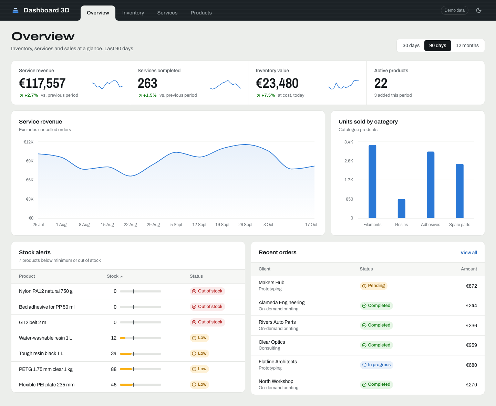

# Dashboard 3D

A frontend MVP of an operations dashboard for a 3D printing business. It shows **inventory**, **services** and **products** at a glance, with charts that make trends easy to spot.

> All data is simulated. This is a visual prototype for validating the layout and the metrics before connecting real data.



## Features

- **Four views**, switched from the tabs in the top bar:
  - **Overview**: service revenue, completed services, inventory value, stock alerts and recent orders.
  - **Inventory**: stock by category, incoming vs. outgoing units, and a sortable SKU table with a stock meter that marks each product's minimum.
  - **Services**: orders over time, orders by service type, average lead time and completion rate.
  - **Products**: units sold by category, top 10 best sellers and the full catalogue with price and margin.
- **Time period selector** (30 days, 90 days, 12 months) that updates every number and chart. KPIs show the change against the previous period.
- **Light and dark mode**: follows the system setting, can be switched manually and is remembered between visits.
- **Responsive**: works on desktop, tablet and mobile.
- Amounts are shown in **euros** (`en-IE` format).

## Requirements

- [Node.js](https://nodejs.org/) **20.19+** or **22.12+**
- npm (included with Node.js)

## Installation

```bash
# 1. Get the code
git clone <repository-url>
cd dw-thought3D-dashboard

# 2. Install dependencies
npm install
```

## Usage

### Run locally

```bash
npm run dev
```

Then open [http://localhost:5173](http://localhost:5173) in your browser. Changes to the code reload automatically.

Each view has its own link, so you can share it directly:

| View | URL |
|------|-----|
| Overview | `http://localhost:5173/#/overview` |
| Inventory | `http://localhost:5173/#/inventory` |
| Services | `http://localhost:5173/#/services` |
| Products | `http://localhost:5173/#/products` |

### Build for production

```bash
npm run build     # outputs a static site to dist/
npm run preview   # serves the build at http://localhost:4173
```

The `dist/` folder is a fully static site. You can deploy it to any static host (Netlify, Vercel, GitHub Pages, S3, Nginx…).

### Other scripts

| Command | Description |
|---------|-------------|
| `npm run lint` | Checks the code with oxlint |

## Tech stack

- [React 19](https://react.dev/) + [TypeScript](https://www.typescriptlang.org/) + [Vite](https://vite.dev/)
- [Recharts](https://recharts.org/) for charts
- [Lucide](https://lucide.dev/) for icons
- Plain CSS with design tokens (no UI framework). Typeface: [Archivo](https://fonts.google.com/specimen/Archivo)

## Project structure

```
src/
├── data/mock.ts        # All simulated data (replace with API calls)
├── types.ts            # Shared data types
├── views/              # Overview, Inventory, Services, Products
├── components/
│   ├── layout/         # Top navigation and page header
│   ├── charts/         # Line, area, bar and donut charts + palette
│   ├── KpiCard.tsx     # KPI with change indicator and sparkline
│   ├── DataTable.tsx   # Sortable table
│   └── ...             # Status badges, stock meter, panels
├── hooks/              # Hash routing and theme
├── lib/format.ts       # Number, currency and date formatting
└── styles/             # Design tokens and global styles
```

## Connecting real data

Every number in the dashboard comes from `src/data/mock.ts`. To use real data, replace the functions in that file with calls to your API, returning the same types defined in `src/types.ts`. The views and charts don't need to change.

To change the currency or regional format, edit `LOCALE` and `CURRENCY` in `src/lib/format.ts`.
